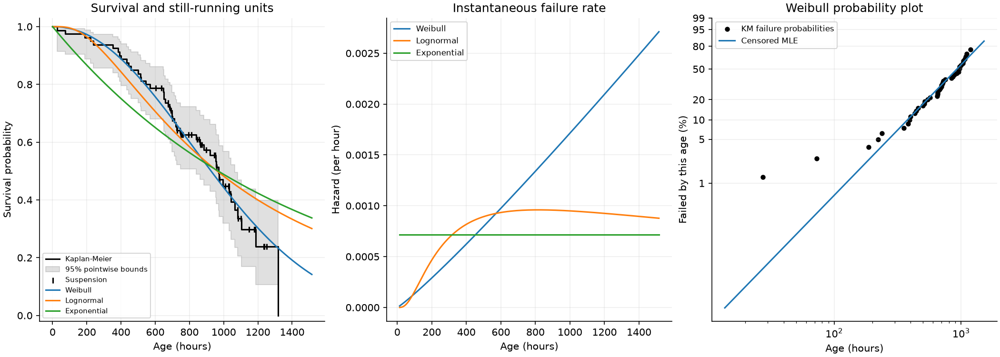

# Equipment-life analysis

I wanted to compare equipment lifetimes without ignoring the units that had not
failed. A still-running seal has already survived its recorded operating hours.
That information should affect a life estimate, even though I do not know its
eventual failure time.

## Try the maintenance example

From the repository root, with the README's Python environment active:

```sh
python -m streamlit run DistroFit.py --server.address=127.0.0.1 --server.headless=true --browser.gatherUsageStats=false
```

I open **Reliability** in the sidebar. The editable table starts with the
[generated pump-seal log](../examples/reliability/equipment_log.csv).
I choose a confidence level, inspect a model and enter a planning age in hours.
The downloads save the complete calculation as JSON, the life estimates as CSV
and the three charts as PNG. The risk-count expander shows how many units were
still observed before each age. Invalid edits remove the previous results and
downloads until I fix the log.

I can also run the same calculation without a browser:

```sh
python reliability_report.py --sample --out /tmp/seal-life
python reliability_report.py examples/reliability/equipment_log.csv --confidence .99 --out /tmp/seal-life-99
```

The output directory must be new. I get `reliability.json`, `observations.csv`,
`models.csv`, `kaplan_meier.csv`, `curves.csv` and `reliability.png`. All life values
are in hours and hazard is per hour. Extra input columns such as unit identifiers
are for my reference in the editor; exported observations retain only `time` and
`failed`. Reports contain the input ages, so I keep private exports out of Git.

## Preparing my own log

```csv
unit_id,time,failed
SEAL-A,430,1
SEAL-B,700,0
SEAL-C,850,1
SEAL-D,900,0
```

- `time` is a finite, positive number of operating hours since new installation.
- `failed=1` means a failure happened at exactly that age.
- `failed=0` means it was still working when observation stopped at that age.
  This is a right-censored observation, also called a suspension.
- I use one row per independent lifetime, one component population, one failure
  definition and comparable operating conditions. I do not enter repeated
  snapshots of the same unit as separate lifetimes.

The module rejects invalid ages, missing flags and non-binary flags instead of
dropping rows. Zero hours, left-censoring (already failed before observation),
interval-censoring (failure occurred between inspections), delayed entry and
frequency-weighted rows are unsupported. I expand counts into individual rows
only when they really represent independent units. CSV duplicate headers are
rejected before pandas can rename them.

## What I learn from the generated seals

This is a maintenance planning exercise, not field evidence. I generated 80 seal
lifetimes from a Weibull distribution with shape 2.1 and scale 1,200 hours using
seed 20261104. I independently generated last-observation ages between 600 and
1,400 hours. Each row records whichever came first, failure or last observation.
`generate_demo()` in `reliability_report.py` reproduces the committed CSV.

I observe **45 failures, 35 suspensions and 62,799.049 total operating hours**.
At the default 95% confidence level I get:

| Model | Mean life, hours (approximate interval) | B10, hours (approximate interval) | AIC |
| --- | --- | --- | --- |
| Weibull | 976.4 (843.5 to 1,130.2) | 378.3 (288.8 to 495.5) | 721.85 |
| Lognormal | 1,405.0 (1,018.6 to 1,937.9) | 315.3 (241.6 to 411.4) | 737.77 |
| Exponential | 1,395.5 (1,042.0 to 1,869.1) | 147.0 (109.8 to 196.9) | 743.69 |



I first check the stepped Kaplan-Meier survival curve, which estimates survival
without choosing a distribution. Suspension marks do not make it fall. The fitted
Weibull curve broadly follows those steps. AIC, a comparison that balances fit
against model complexity, ranks Weibull first for this log. That is consistent
with how the example was generated; it is not evidence that every seal follows
a Weibull distribution.

The fitted Weibull shape is 2.104, above one, so its hazard increases with age.
Hazard is an instantaneous failure rate among surviving units, not the chance of
failure during a whole hour. The lognormal hazard can rise and then fall; the
exponential model assumes a constant rate. The probability plot compares observed
failure probabilities with a straight model line on transformed axes. Curvature
or systematic departures would make me investigate the selected model.

For a discussion about inspecting at 400 hours, Weibull predicts **88.8% survival**.
B10 is about 378 hours, with an approximate interval from 289 to 495 hours. I would
compare that uncertainty, inspection costs and failure consequences before
proposing a schedule. B10 is a population percentile; it does not say an individual
seal will fail at that age. The confidence interval describes uncertainty in the
estimated percentile, not the spread of individual seal lifetimes.

If I discard all 35 suspensions and fit only failures, Weibull mean life drops
from **976.4 to 675.6 hours**, about 31% lower. Those rows preferentially retain
shorter lives, which explains the bias. Marking suspensions as failures would
also be wrong: their actual failure ages are unknown.

For these first lives, the mean is **mean time to failure (MTTF)**. I can interpret
it as **mean time between failures (MTBF)** for independent renewal cycles only
when each replacement restores the unit to as-new condition. Adding repair times,
minimal repairs or aging equipment requires a different model.

## Assumptions and limits

Censoring must be independent of hidden failure risk. A fixed test end or an
unrelated observation cutoff can satisfy this assumption; removing a seal because
it looks close to failure can violate it. Mixing different failure causes,
temperatures, loads or maintenance policies can also invalidate one fitted curve.

Model tails beyond the last observed age are extrapolations. Similar AIC values
do not identify a true model, and even a better AIC does not establish fit quality.
The empirical survival curve ends at the last observed age. Its gray band is a
pointwise interval, not a simultaneous confidence band for the whole curve.
At survival endpoints zero and one I use the conventional boundary values; a
flat curve with no failures does not establish certain survival.

With no failures, the report retains the empirical curve but excludes all life
models and explains why. Weibull and lognormal need at least two distinct observed
failure ages here. Exponential can use one failure but the uncertainty is large.
The report warns below ten failures and above 80% censoring. Confidence intervals
use a large-sample approximation; sparse or heavily censored logs need more data
and specialist interval methods before consequential decisions.

## Calculation design

`reliability.py` computes the right-censored log likelihood:

```text
log L = sum over failures of log f(time)
      + sum over suspensions of log S(time)
```

`f` is the lifetime density and `S` is survival probability. Every model fixes
location at zero, so installation is age zero. I normalize log ages before fitting
and restore their original scale afterwards. Weibull uses a root of the profile
likelihood score for shape, then calculates scale. Lognormal minimizes negative
log likelihood in mean-log-age and log-standard-deviation coordinates with a
stable normal log-survival function. Exponential mean is total observed exposure
divided by the number of failures. Boundary or non-identifiable fits are excluded
with a reason, rather than replaced by default parameters.

For Weibull, `shape=beta`, `scale=eta`, mean life is
`eta * Gamma(1 + 1/beta)`, and B10 is `eta * (-log(.9))**(1/beta)`.
For lognormal, `shape=sigma` and `scale=exp(mu)`; mean is
`exp(mu + sigma**2/2)` and B10 is `exp(mu + normal_quantile(.1)*sigma)`.
Exponential B10 is `mean * -log(.9)`. AIC is `2*k - 2*log L`, where `k` is
one for exponential and two for Weibull and lognormal. This is an in-sample
comparison on the same censored log, separate from DistroFit's ordinary
measurement train/test scoring.

The observed-information matrix is the central-difference Hessian of negative
log likelihood in the dimensionless fitting coordinates. I invert it only when
it is positive definite. Exponential uses its analytic information. The delta
method propagates this covariance to log mean life and log B10 using analytic
gradients. Exponentiating `log estimate +/- z * standard error` gives positive,
asymmetric approximate intervals. These are not bootstrap, exact or profile
likelihood intervals. The confidence level is configurable through the API and CLI.

Kaplan-Meier processes each distinct observed age with the number at risk just
before that age. Failures and suspensions tied at an age share that risk set;
failures are processed before the suspensions leave. Greenwood variance and a
log-log transformation give pointwise survival intervals. Probability plots use
failure jumps from that curve: Weibull uses `log(-log(S))` against log age,
lognormal uses the normal failure quantile against log age, and exponential uses
`-log(S)` against age. Undefined zero/one survival endpoints are omitted. The line
comes from the censored MLE; no regression on plotting ranks is used for fitting.

## References and checks

I checked the likelihood convention against
[NIST's censored maximum likelihood guide](https://www.itl.nist.gov/div898/handbook/apr/section4/apr412.htm)
and the empirical curve against
[NIST's Kaplan-Meier guide](https://www.itl.nist.gov/div898/handbook/apr/section2/apr215.htm).
The regression test uses
[NIST's published Weibull example](https://www.itl.nist.gov/div898/handbook/apr/section4/apr413.htm):
ten failures and ten suspensions give shape 1.7208, scale 606.528 hours,
mean 540.737 hours, log likelihood -75.135 and AIC 154.27. The lognormal AIC is 154.39.
Other tests compare estimates with independent SciPy
[`CensoredData` fits](https://docs.scipy.org/doc/scipy/reference/generated/scipy.stats.CensoredData.html).

```sh
python -m pytest tests/test_reliability.py tests/test_reliability_workflows.py -q
python -m pytest -q
```

The tests also cover hand-calculated exponential life intervals and tied survival
steps, unit scaling, complete data, invalid input, sparse and all-suspended logs,
deterministic generation, exported charts/tables, real CLI processes and the
Streamlit page's model choice, confidence controls, edits and stale-result cleanup.
CI runs the complete suite and exports this maintenance example as a downloadable
artifact using the same functions as the app.
